# Band Wall — Item links feature test

**October 25, 2026 · Local development · iOS 26.1 simulator, API, database and web unit tests**

Scope: the uncommitted “Add a link” feature on top of `9b1d452`. Finance work and unrelated commits were outside this run. **No commits were made:** finance changes remain uncommitted, so your commit hold is still in effect.

An available inherited-model driver captured C2 and C7; Sonnet was unavailable. I reviewed the raw evidence and gave every verdict. The driver’s read-only helper required execution by the main agent with local access. All other checks were driven solo, including the stateful native flows.

No Docs creation connector was available, so this report is a local Markdown artifact with its evidence alongside it. Tracker: [Attach links to items](https://trello.com/c/jhggFZOC).

## Summary

**13 Codex checks: 12 ✅ Pass · 1 ⚠️ Stood in · 0 failures · 0 fixes. Three checks need your physical phone.**

| Check | How tested | Verdict |
|---|---|---|
| C1 — 🔵 C1 — A member can attach a named link to tasks, shows, rehearsals, meetings, goals and reminders. | Manual local API requests | ✅ Pass |
| C2 — 🔵 C2 — Saved links persist and the same destination is visible to another band member. | Two-account API readback | ✅ Pass |
| C3 — C3 — Members can remove their own links. | Manual local API requests | ✅ Pass |
| C4 — 🔵 C4 — Members cannot remove another person’s link; admins can remove members’ links. | Manual local API requests | ✅ Pass |
| C5 — C5 — Missing schemes default to HTTPS, blank names use the hostname, query/fragment survive, and unsafe/invalid URLs are rejected. | Manual local API requests | ✅ Pass |
| C6 — 🔵 C6 — Anonymous and cross-board reads/writes are denied. | Manual local API requests | ✅ Pass |
| C7 — C7 — Each link has one parent, protected storage, and deleting its parent cleans up its links. | DB constraints + API cascade | ✅ Pass |
| C8 — C8 — Web controls preserve drafts after failed saves, focus invalid URL input and render safe new-tab links (unit evidence; browser visual check may remain blocked). | Web component tests | ⚠️ Stood in |
| C9 — 🔵 C9 — Native Add a link focuses Name first, flags invalid/blank URL and protects a cancelled draft. | Native simulator + captured responses | ✅ Pass |
| C10 — C10 — All six native item detail screens show their saved link names and destinations. | Native simulator + captured responses | ✅ Pass |
| C11 — 🔵 C11 — A link added through the native form is visible after leaving and reopening its item. | Native simulator + captured responses | ✅ Pass |
| C12 — C12 — Dedicated unit tests, web/mobile/client TypeScript checks and touched-file lint pass. | Units, TypeScript, lint | ✅ Pass |
| C13 — 🔵 C13 — A failed native save keeps the name and URL; retrying the unchanged draft saves successfully. | Native simulator + captured responses | ✅ Pass |
| P1 — 🔵 P1 — On a physical phone, tap actual Drive and Sheets links and confirm the expected app/browser opens with the sharing access your band expects. | Physical phone | 📱 Over to you |
| P2 — P2 — On a physical phone, change network or lose connectivity during Save; the draft remains and can be retried after reconnection. | Physical phone | 📱 Over to you |
| P3 — P3 — On a physical phone, type and paste a multiword link name and a long URL, then save promptly; the full text is preserved and Save stays reachable above the keyboard. | Physical phone | 📱 Over to you |

No product bugs were found in the completed checks. The live web visual check remains blocked; actual Drive/Sheets opening and physical keyboard/network behavior remain below.

## Part 1 — 🤖 Codex evidence

Review boxes start unchecked intentionally. They record your review; the verdicts above record my test results. Trello checks also remain unchecked until you confirm.

### C1 — ✅ Pass

- [ ] 🔵 C1 — A member can attach a named link to tasks, shows, rehearsals, meetings, goals and reminders.

Member-authenticated manual API calls created one named link on each of the six item types. Each POST returned 201 and the expected title, URL and member creator ID. These were API creations; native display is checked separately in C10.

```text
TASK 201 · SHOW 201 · REHEARSAL 201 · MEETING 201 · GOAL 201 · REMINDER 201
```

[Full requests and responses](evidence/live-api.json).

### C2 — ✅ Pass

- [ ] 🔵 C2 — Saved links persist and the same destination is visible to another band member.

The driver captured 12 GETs: owner and member independently listed each item’s links. Every response was 200, and every owner/member pair matched, including IDs and destinations. At this point the task had three links and each other item had one. Query strings and fragments survived storage.

```text
owner/member: TASK 3/3; SHOW 1/1; REHEARSAL 1/1; MEETING 1/1; GOAL 1/1; REMINDER 1/1
url: https://docs.google.com/spreadsheets/d/qa-example?usp=sharing#gid=12
```

[Captured readback](evidence/C2-driver-readback.json).

### C3 — ✅ Pass

- [ ] C3 — Members can remove their own links.

A member created a disposable link, then deleted their own link through the API. The removal returned 200 with `{"deleted":true}`.

[Requests and responses, C3](evidence/live-api.json).

### C4 — ✅ Pass

- [ ] 🔵 C4 — Members cannot remove another person’s link; admins can remove members’ links.

A member’s DELETE of the owner’s link returned 403, with “You can only remove your own links.” The owner’s link remained in subsequent readback. An admin then deleted a different member-owned link successfully (200).

[Requests and responses, C4](evidence/live-api.json).

### C5 — ✅ Pass

- [ ] C5 — Missing schemes default to HTTPS, blank names use the hostname, query/fragment survive, and unsafe/invalid URLs are rejected.

The API normalized a scheme-less Sheets address to HTTPS while preserving `?usp=sharing#gid=12`. A blank title became `drive.google.com`. Seven invalid inputs returned 400: javascript, data, file and FTP schemes; embedded username/password; malformed text; and an empty URL. These are validation samples, not real credentials.

[Requests and responses, C1/C5](evidence/live-api.json).

### C6 — ✅ Pass

- [ ] 🔵 C6 — Anonymous and cross-board reads/writes are denied.

Anonymous GET returned 401. A member reading a board they did not belong to received 404. An admin placing an isolation-board parent under the QA board, reading a parent through the wrong board, or deleting a link through the wrong board received 404. A malformed parent ID returned 400. This matches the project’s policy of hiding inaccessible boards.

[Requests and responses, C6](evidence/live-api.json).

### C7 — ✅ Pass

- [ ] C7 — Each link has one parent, protected storage, and deleting its parent cleans up its links.

The driver’s read-only database capture showed exactly one non-null parent on each of the eight initial links, an exactly-one-parent CHECK, cascading foreign keys and RLS enabled. A separate manual API sequence created a temporary task and link, deleted the task, then received 404 when trying to delete the cascaded link.

```sql
CHECK (num_nonnulls("taskId", "eventId", "goalId", "reminderId") = 1)
-- parent foreign keys: ON DELETE CASCADE
-- relrowsecurity: true
```

[Database observations](evidence/C7-driver-db.json) · [Cascade requests, C7](evidence/live-api.json).

Protection is evidenced by the schema configuration and API boundaries; direct anonymous database access was not separately exercised.

### C8 — ⚠️ Stood in

- [ ] C8 — Web controls preserve drafts after failed saves, focus invalid URL input and render safe new-tab links (unit evidence; browser visual check may remain blocked).

Six web component tests passed, including failed-save draft retention/retry, invalid-input focus and safe new-tab anchor attributes. Unit rendering stood in for live browser interaction and visual inspection. The saved site permission denied the local browser page; no alternate browser or URL was used to bypass it.

```text
npm test -w apps/web -- --runInBand item-links.test.tsx
Test Suites: 1 passed; Tests: 6 passed
```

[Web unit log](evidence/web-unit.txt). Live web layout and real clicks remain unverified.

### C9 — ✅ Pass

- [ ] 🔵 C9 — Native Add a link focuses Name first, flags invalid/blank URL and protects a cancelled draft.

On the isolated QA iOS simulator, opened Task → Add a link. The Name caret appeared first. Save with no URL highlighted URL and showed “Enter a link”; a javascript URL showed “Enter a valid http or https link.” Cancel with a draft displayed the discard/keep-editing alert.

The form was populated through accessibility field values because synthesized typing/paste was unreliable. That does not establish a product defect; physical typing, paste and keyboard behavior remain P3.

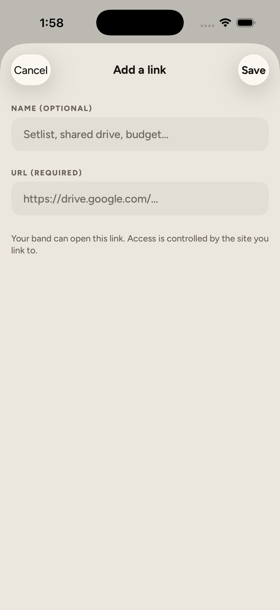

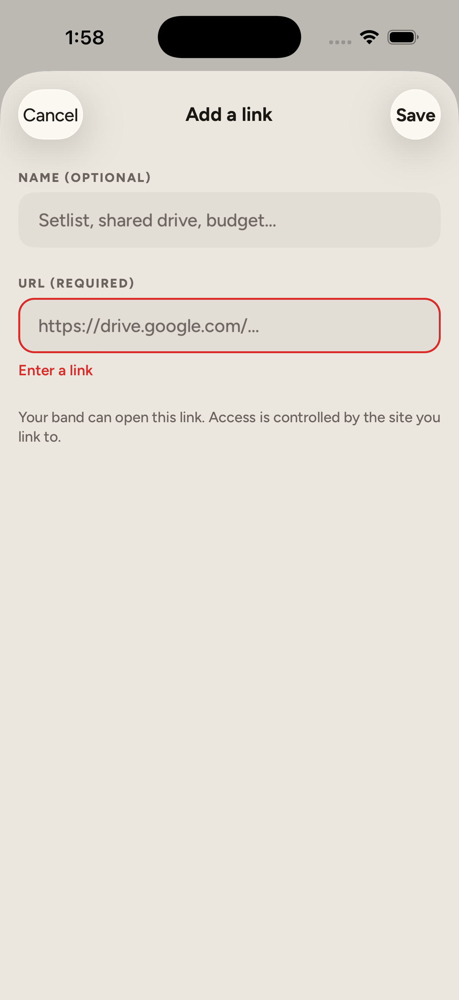

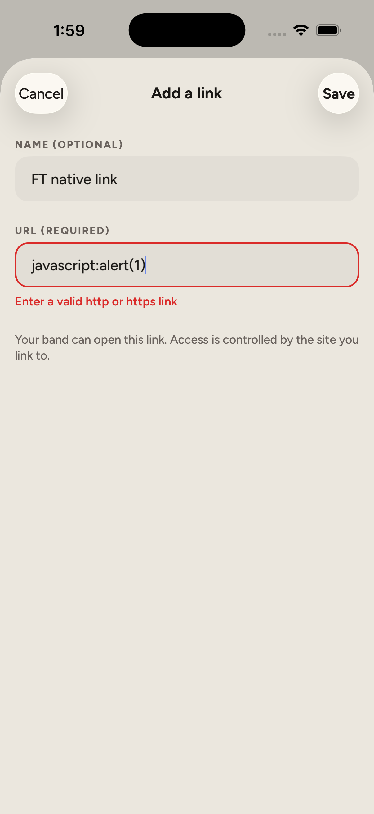

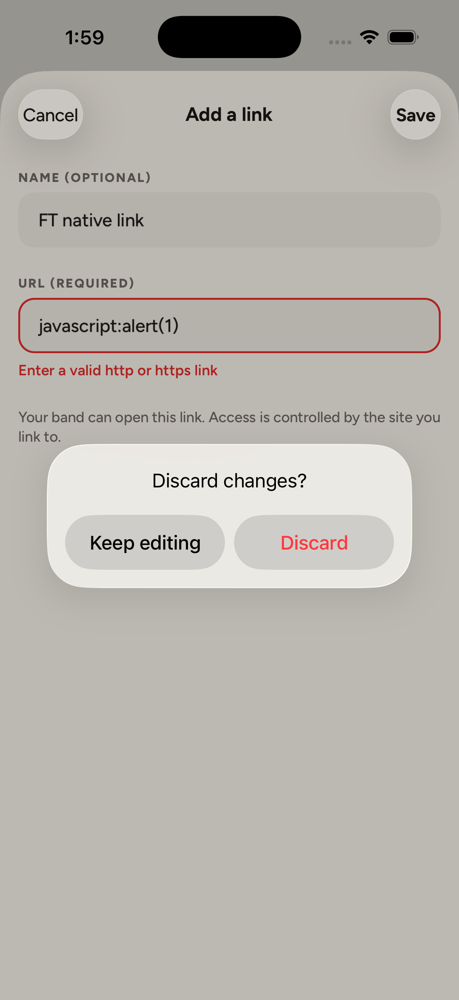

### C10 — ✅ Pass

- [ ] C10 — All six native item detail screens show their saved link names and destinations.

As the disposable QA owner, opened all six native detail screens. Each displayed its expected saved name and destination plus Add a link. Long destinations intentionally ellipsized to one line; saved names remained readable. Reminder was checked in light and dark appearance, then returned to light. These are placeholder Google destinations; they were not opened.

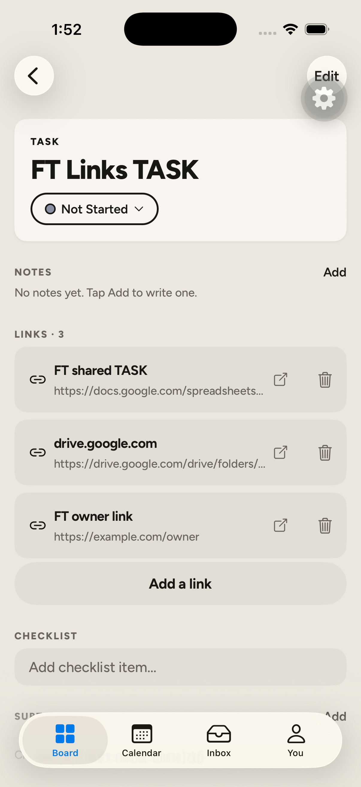

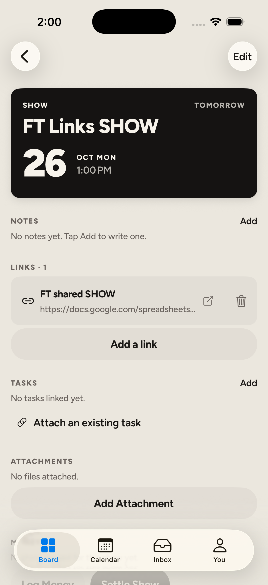

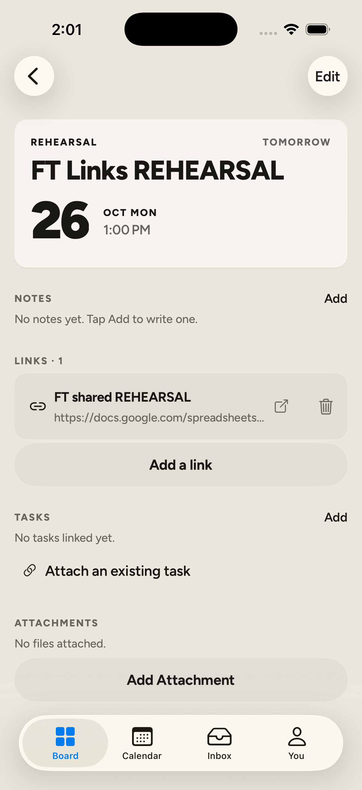

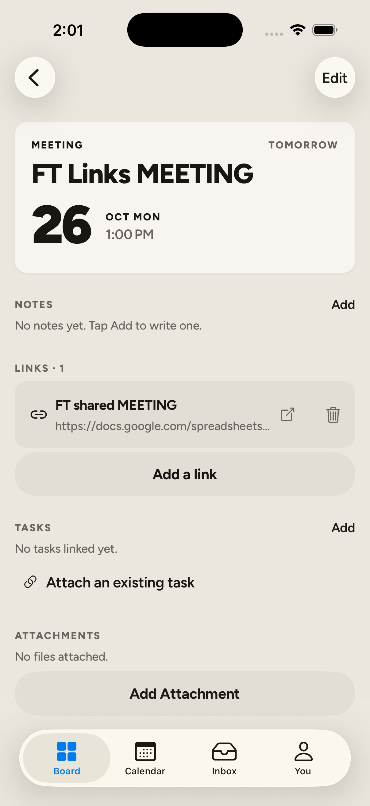

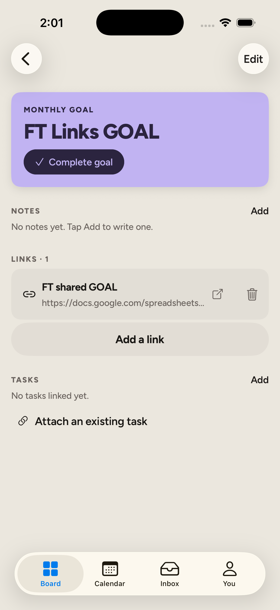

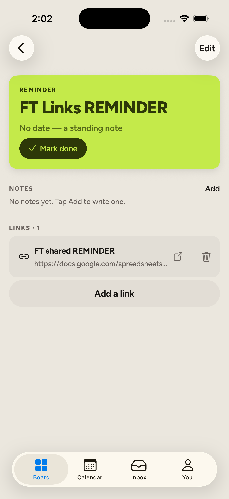

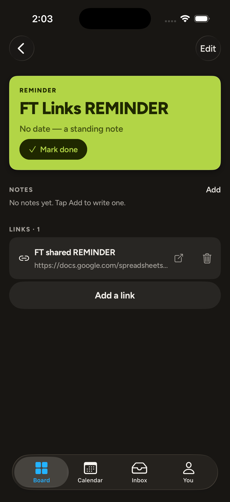

### C11 — ✅ Pass

- [ ] 🔵 C11 — A link added through the native form is visible after leaving and reopening its item.

Filled the native form with “FT native link” and a scheme-less Sheets URL, then tapped Save. The item showed four links. Navigated back and reopened the task; the saved row remained. The destination was normalized to HTTPS and retained its query and fragment.


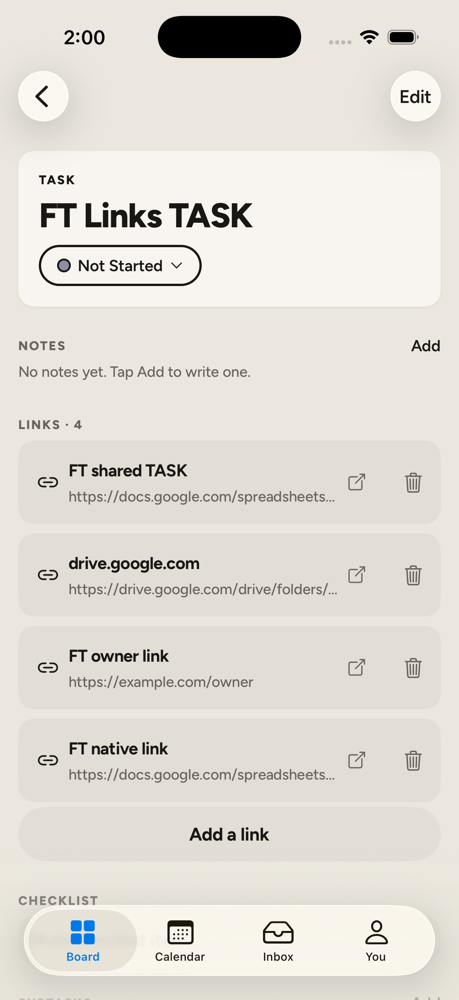

### C12 — ✅ Pass

- [ ] C12 — Dedicated unit tests, web/mobile/client TypeScript checks and touched-file lint pass.

Reran the dedicated suites during this QA: 24 API tests and six web tests passed. API’s test script also ran TypeScript. Web, mobile and API-client type checks exited 0. Lint on touched API, web and mobile files exited 0.

```text
API links.service.spec.ts: 24 passed
Web item-links.test.tsx:    6 passed
API/web/mobile/client TypeScript: exit 0
Touched-file API/web/mobile lint: exit 0
```

[API unit log](evidence/api-unit.txt) · [Web unit log](evidence/web-unit.txt) · [Type checks](evidence/typecheck.txt) · [API lint](evidence/api-lint.txt) · [Web lint](evidence/web-lint.txt) · [Mobile lint](evidence/mobile-lint.txt).

The earlier implementation pass also ran the broader suites (636 tests); that broader run was not repeated during this feature-test.

### C13 — ✅ Pass

- [ ] 🔵 C13 — A failed native save keeps the name and URL; retrying the unchanged draft saves successfully.

Submitted “FT retry draft” through the native form while a QA-only proxy returned a controlled 503 for link creation. The error appeared and both fields stayed intact. Restored normal forwarding and tapped Save without changing the draft; the API returned 201 and the task displayed the fifth link.

```text
2026-10-25 21:06:20 UTC  POST /boards/<QA>/links → 503
2026-10-25 21:06:36 UTC  POST /boards/<QA>/links → 201
```

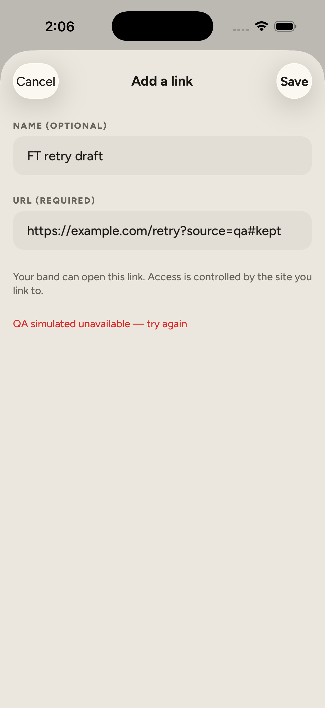

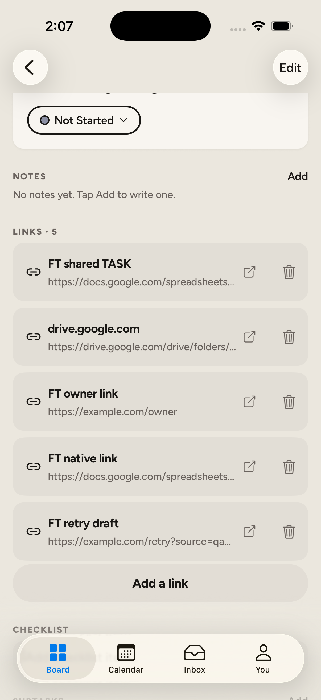

[Captured responses](evidence/C11-proxy-results.json). This proves server-error retry; actual connectivity transitions remain P2.

## Part 2 — 📱 Phone-only

Use your normal test band and accounts; no production data was changed by this run.

### P1

- [ ] 🔵 P1 — On a physical phone, tap actual Drive and Sheets links and confirm the expected app/browser opens with the sharing access your band expects.

On your phone, open an existing task → Add a link. Attach a real Drive folder and a real Google Sheet that your band can access. Tap each saved row, then have another band member open the same links. Confirm the intended document/app opens and Google’s sharing permissions work for both people. The QA URLs in screenshots are placeholders and will not open real files.

### P2

- [ ] P2 — On a physical phone, change network or lose connectivity during Save; the draft remains and can be retried after reconnection.

On your phone, enter a draft link, interrupt connectivity while saving, and wait for the error. Confirm both fields remain. Reconnect and retry without editing; confirm one saved row appears after reopening the item.

### P3

- [ ] P3 — On a physical phone, type and paste a multiword link name and a long URL, then save promptly; the full text is preserved and Save stays reachable above the keyboard.

On your phone, open Add a link and type a multiword name. Paste a long URL with a query and fragment, then tap Save promptly. Confirm the full name and destination survive reopening. Repeat with the on-screen keyboard visible and confirm Save remains reachable.

## Test data and environment

All data was created on the local Supabase/API stack. Accounts and rows are retained pending your review; no demo reseed was run. The [sanitized fixture manifest](fixture.example.json) records parent and initial link IDs. Native additions are named below. Credentials and access tokens are excluded from this report.

| What | Where | Purpose | Status |
|---|---|---|---|
| Disposable owner and member | Local Auth/User: `bba7eb0d-1eb1-403b-9b16-6d3c08320372`, `7528c346-1de1-4026-b815-42f01e360c30` | Admin/member permissions | Kept until review |
| FT Links QA | Board `78267435-7851-46c9-84b2-c7c3b2f931e9` | Six item types, shared links | Kept until review |
| FT Links Isolation | Board `426fc26a-53bc-46eb-8c41-e61a440e2921` | Cross-board boundary | Kept until review |
| Seven parent items | Six QA items and one isolation task; IDs in manifest | Parent coverage and isolation | Kept until review |
| Ten saved ItemLink rows | Five on QA task; one on each other QA item | Eight initial rows plus “FT native link” and “FT retry draft” | Kept until review |
| Default statuses, memberships and activity | Children of the two QA boards | App setup and test activity | Kept; remove with QA data after review |
| Own/admin removal samples and cascade-only task/link | Local QA board; IDs in API evidence | Deletion checks | Already removed during checks |
| Band Wall Links QA simulator | `F21591AB-2FFD-41C8-B3CB-C77C2F48375D` | Isolated native account and bundle | Shut down; retained for review |

The QA-only Metro server (8082), failure proxy (3002) and screenshot watcher were stopped. Existing web (3000), API (3001) and Metro (8081) servers remain running. The original iPhone 17 Pro Simulator window was restored without saving or discarding its layout draft; it still shows the pre-existing stale-hostname load error.

Temporary capture code remains outside the repo in the scratch folder, not in the product or report. The staged finance patch was compared byte-for-byte with the preflight snapshot and is unchanged. No QA source patch or debug logging was introduced.

Tracker mappings are saved in [tracker.json](tracker.json) for syncing only after your verification. The card stays in Testing; only you move it to Done.

Tick what looks right, comment on anything that doesn’t, then tell me “done”.

